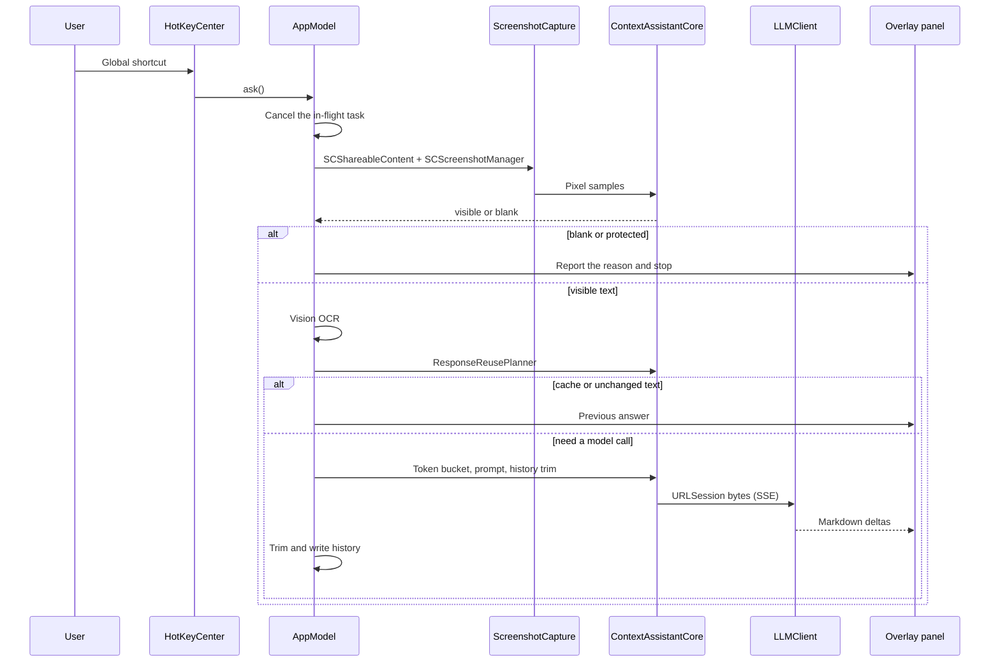

# Architecture

Context Assistant is a macOS 14+ utility that answers questions about one window the user has explicitly selected. Capture Lab and Capture Diagnostics are separate research tools. They share no capture path with the assistant.

The portable rules live in the Swift package `ContextAssistantCore`. AppKit, ScreenCaptureKit, Vision, Carbon, and Keychain stay in the app targets so the package builds on Linux and on a Mac.

## Modules

| Module | Target | Responsibility |
| --- | --- | --- |
| `ContextAssistantCore` | Swift package | Hashing, similarity, blank-frame heuristic inputs, token bucket, response cache, SSE parser, prompt builder, history trimming, OpenAI-compatible streaming client, capture policy constants, diagnostics JSON types |
| `Shared/MacCapture` | Compiled into Context Assistant | Screen Recording check, window list, system picker, `SCScreenshotManager` still capture, pixel sampling, Vision OCR |
| Context Assistant | App | Hotkey, pipeline, Keychain, floating panel, history file, settings |
| Capture Lab | App | Owns its own windows and toggles public `NSWindow` properties on those windows only |
| Capture Diagnostics | App | Runs one independent probe per public capture API and writes JSON |
| Integration tests | Xcode unit-test bundle, hosted in Context Assistant | Pixel sampling plus permission-gated capture. Skipped when Screen Recording is not granted |

Core does not import AppKit, ScreenCaptureKit, Vision, or Security.

## Policy that the code enforces

`CapturePolicy` in Core is the switch the assistant compiles against:

- The assistant window-sharing value has a single case, `readOnly`. The overlay sets `NSWindow.sharingType` from that case. There is no stealth setting.
- `allowAPIFallback` is `false`. A blank or protected frame ends the assistant pipeline.
- Diagnostics JSON is constructed so `usedAsFallback` is always `false` and `independentProbe` is always `true`. The report type has no way to record a fallback success.
- Capture Diagnostics does not show or save pixels. It records whether a frame is non-uniform. Context Assistant never calls `CGWindowListCreateImage` or the diagnostics stream probe.

## Data flow

Selection happens before this flow. The user either highlights a row from `SCShareableContent` or confirms a window in `SCContentSharingPicker`. The hotkey never picks a window by itself. The most recent explicit selection is the only target.

`SCContentSharingPicker` returns an `SCContentFilter`. The in-app list stores a window id and, on each capture, resolves that id through `SCShareableContent` again. A missing id is a "window unavailable" error, not a search for a replacement window.

## Concurrency

- `AppModel`, `SettingsStore`, `HistoryStore`, and `SystemWindowPicker` are `@MainActor`. SwiftUI and AppKit calls stay there.
- `TokenBucket` and `ResponseCache` are actors. The pipeline awaits them. They do not touch the UI.
- Each Ask starts one unstructured `Task` stored on `AppModel`. That task is the only background work the assistant keeps. The task uses structured `await` for capture, OCR, the cache, the rate limiter, and the model stream.
- `LLMClient.stream` creates an `AsyncThrowingStream`. The producer `Task` is cancelled from the stream's `onTermination`, which is how a new Ask aborts the socket read.
- OCR runs on a detached task because `VNRecognizeTextRequest` is synchronous and CPU-heavy. Vision does not take a cancellation token. The pipeline checks `Task.isCancelled` before starting OCR and again before any network call. A cancellation during OCR waits until recognition returns, then stops without calling the model.
- ScreenCaptureKit callbacks (`SCContentSharingPickerObserver`, `SCStreamOutput`) are nonisolated. They hop to the main actor or finish a continuation. Capture Diagnostics retains its stream output object until the continuation resumes.
- The Carbon hotkey handler is a free function. It schedules the Ask on the main queue. It does not capture Swift state itself.

No global mutable capture state is shared between the three apps. They are separate processes.

## Cancellation

A new Ask, the Stop button, and Escape all cancel the stored task.

Cancellation is cooperative:

1. `Task.isCancelled` is checked before capture side effects that can be skipped, after capture, after OCR, and before the model call.
2. Cancelling the task cancels `URLSession.bytes(for:)`. `URLError.cancelled` and `CancellationError` end the stream without an error banner.
3. A cancelled run does not write history and does not fill the response cache.
4. A partial answer that already reached the panel stays on screen so the user can read it. The status line says it was cancelled.

Capture Diagnostics probes are sequential. Cancelling is "close the window"; there is no second strategy queued behind the first.

## Memory

- The still image is a local `CGImage`. It is not stored on the model, in history, or on disk. It is released when the capture function returns.
- Capture dimensions are capped by `CaptureSizing` (long edge 1600 pixels by default) before ScreenCaptureKit allocates the frame.
- The blank-frame check uses a 32×32 sample, not the full bitmap.
- History stores an excerpt of the OCR text (default 2,000 characters), not the frame. `HistoryTrimmer` then enforces a turn count and a character budget, dropping the oldest turns first.
- `ResponseCache` is an LRU with a fixed capacity (default 32 strings).
- The model stream stops after `LLMClient.maxStreamCharacters` (default 100,000) so a runaway response cannot grow without bound.
- The SSE parser keeps only the current event's data lines.
- Logs record lengths, hashes, status codes, and error descriptions. They do not record the API key or the OCR text.

## Persistence

| Data | Where |
| --- | --- |
| LLM API key | Login keychain (`Security`), service `dev.codychen.ContextAssistant`, account `llm-api-key` |
| Base URL, model, shortcut, opacity, layout | `UserDefaults` |
| Conversation | Application Support `history.json`, rewritten after every successful answer, already trimmed |

The key is never written to `UserDefaults`, Info.plist, source, or the history file.

## Processes

Context Assistant is the only process that sends OCR text to a model. Capture Lab never captures. Capture Diagnostics captures only the window selected in its own window and writes a local JSON report. None of the apps inject code, attach as a debugger, or call private window-server symbols.
